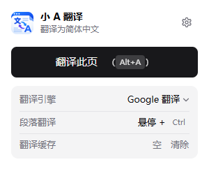

# 小 A 翻译

非常极简的网页翻译扩展（Chrome / Edge，Manifest V3），支持网页翻译和 YouTube 双语字幕。

市面上已经有很多翻译插件，但对我来说都过于冗余了，我不需要太多的功能，所以自己做了个极简的。

## 安装
本扩展未上架应用商店，需要以「开发者模式」手动加载：

1. 在 [Releases](https://github.com/iamzwq/a-translate/releases/latest) 页面下载最新的 `a-translate-vX.Y.Z.zip`，解压到本地固定位置，例如 `D:\a-translate`（加载后请勿移动或删除该文件夹）
   - 也可以直接克隆本仓库：`git clone https://github.com/iamzwq/a-translate.git`
2. 在浏览器地址栏打开扩展管理页：
   - Chrome：`chrome://extensions`
   - Edge：`edge://extensions`
3. 打开「开发者模式」开关（Chrome 在右上角，Edge 在左侧栏）
4. 点击「加载已解压的扩展程序」，选择包含 `manifest.json` 的文件夹
5. 点击工具栏的拼图图标，将「小 A 翻译」固定到工具栏，方便使用
6. 打开 `chrome://extensions/shortcuts`（Edge 为 `edge://extensions/shortcuts`），确认「小 A 翻译」的快捷键为 `Alt+A`；若为空或与其他扩展冲突，可在此手动设置

### 更新
1. 从 [Releases](https://github.com/iamzwq/a-translate/releases/latest) 下载新版 zip，解压后覆盖原文件夹（若是克隆的仓库，执行 `git pull` 即可）
2. 在扩展管理页点击「小 A 翻译」卡片上的刷新按钮，并刷新已打开的网页

> 默认快捷键只在首次安装时生效。如果更新后快捷键缺失，请移除扩展后重新加载，或按第 6 步手动设置。

## 使用
- 点击扩展图标打开面板，点「翻译此页」；或直接按 `Alt+A`。再次触发可隐藏或显示译文
- 鼠标悬停在段落上单独按一下 `Ctrl` 翻译该段落，再按一次移除
- 只翻译滚动到可视区域附近的段落，动态加载的内容会自动翻译
- 已经是中文的段落、输入框会被跳过；代码块只翻译其中的注释
- 翻译失败时点击红色提示即可重试
- YouTube 打开字幕（CC）后自动显示双语字幕；中文字幕或 YouTube 自带的自动翻译字幕保持原样

## 翻译细节
功能很少，但在这些地方做了打磨：

**排版**
- 按文字所在的最近块级元素分段，同一段文字不会被外层容器重复翻译；容器自身的文字与子段落混排时，只翻译容器自己的那部分
- 自定义元素（如 YouTube 的 `yt-formatted-string`）按实际显示方式判断是否成段
- 不改动页面原有布局样式
- 兼容 Twitter 这类「文字全在 span 里」的结构，同时跳过按钮、标签等短文本
- 段落中的链接在译文里保留，可直接点击
- 整页翻译跳过导航栏、页脚、按钮和标记为 `notranslate` 的区域，以及整段只是网址、邮箱、版本号、文件路径的文本（悬停翻译不受限）
- 日文、韩文中即使汉字较多也不会被误判为中文而跳过
- 单页应用改写了原文或重新渲染掉译文时，会自动重新翻译

**代码块**
- 段落中的行内代码 `<code>` 保持原样不翻译，译文中同样以代码样式显示；只有行内代码的段落直接跳过
- 只翻译注释，代码本身保持原样
- 识别 highlight.js / Prism / GitHub / Pygments 等高亮的注释；没有高亮的纯文本代码块也能识别 `//`、`/* */`、`#`、`--`、`<!-- -->`，并排除 URL 中的 `//`、`#include`、`#fff` 等误判
- 译文按注释所在行的缩进对齐，斜体显示；不可选中，复制代码时不会带上译文
- 跳过 CodeMirror / Monaco 等在线编辑器和可编辑区域

**触发与切换**
- 只有单独按下并松开 `Ctrl` 才触发段落翻译，`Ctrl+C`、`Ctrl+点击`、`Ctrl+滚轮`缩放都不会误触
- 悬停翻译同样适用于代码块中的单条注释
- 整页译文隐藏时，悬停按 `Ctrl` 会先显示该段译文，再按一次才移除
- 隐藏译文期间新加载的内容，在重新显示时会自动补翻
- 安装扩展之前就打开的标签页也能直接使用，无需刷新

**请求**
- 翻译结果缓存到浏览器关闭为止，重复内容不再请求
- 遇到限流（HTTP 429/503）自动等待后重试；Google 翻译把多个段落合并成一次请求

**YouTube 字幕**
- 直接获取播放器加载的完整字幕，重新断句后再翻译，自动生成的字幕也不会逐词闪烁
- 只预翻当前播放位置往后约 1 分钟的字幕，拖动进度条后从新位置继续
- 字幕随播放器大小缩放，控制栏出现时自动上移，广告期间隐藏
- 切换字幕语言、在站内切换视频都能跟随；需要在打开 CC 前刷新过页面

## 设置
点击扩展图标，在面板底部点「设置」：
- **Google 翻译**：免费，无需 Key（需要能访问 translate.googleapis.com）
- **AI 翻译服务**：可添加多个 OpenAI 兼容接口，分别填写名称、Base URL、Key、模型，例如 DeepSeek：`https://api.deepseek.com/v1` + `deepseek-chat`
- 在扩展面板的「翻译引擎」下拉框中随时切换，切换后新翻译的段落使用新引擎

快捷键可以在 `chrome://extensions/shortcuts` 修改。
