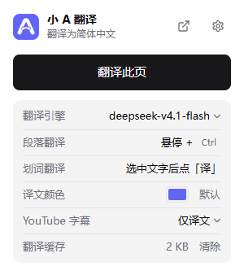
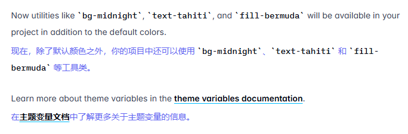

<div align="center">


# 小 A 翻译

专注把 **网页双语翻译** 与 **YouTube 双语字幕** 做到极致，辅以顺手的 **划词翻译** 和 **独立翻译窗口**

[](https://github.com/iamzwq/a-translate/releases/latest)


</div>

> 市面上的翻译插件功能越堆越多，而我真正每天用的只有两样：读网页、看 YouTube。所以小 A 翻译把精力都放在这两件事上，打磨到极致——排版不乱、不闪烁、不误触、不重复请求；再加上随手查词的划词翻译和独立窗口，此外没有多余功能。




## ✨ 特性

- **整页翻译**：只翻译可视区域附近的段落，动态加载的内容自动补翻
- **悬停翻译**：鼠标悬停在段落上单独按一下 `Ctrl` 即可翻译
- **划词翻译**：选中文字点「译」按钮，浮窗可拖动、缩放、固定，支持朗读原文
- **独立窗口**：可拖到桌面任意位置的翻译小窗口，直接输入或粘贴文字翻译
- **YouTube 双语字幕**：自动打开 CC，重新断句不闪烁，支持 Shorts 与直播
- **多翻译引擎**：免费的 Google 翻译，或任意 OpenAI 兼容的 AI 服务（流式输出、页面上下文、术语表）

## 📦 安装

本扩展未上架应用商店，需要以「开发者模式」手动加载：

1. 在 [Releases](https://github.com/iamzwq/a-translate/releases/latest) 页面下载最新的 `a-translate-vX.Y.Z.zip`，解压到本地固定位置，例如 `D:\a-translate`（加载后请勿移动或删除该文件夹）
   - 也可以直接克隆本仓库：`git clone https://github.com/iamzwq/a-translate.git`
2. 在浏览器地址栏打开扩展管理页：
   - Chrome：`chrome://extensions`
   - Edge：`edge://extensions`
3. 打开「开发者模式」开关（Chrome 在右上角，Edge 在左侧栏）
4. 点击「加载已解压的扩展程序」，选择包含 `manifest.json` 的文件夹
5. 点击工具栏的拼图图标，将「小 A 翻译」固定到工具栏，方便使用
6. 打开 `chrome://extensions/shortcuts`（Edge 为 `edge://extensions/shortcuts`），确认「小 A 翻译」的快捷键已设置；若为空或与其他扩展冲突，可在此手动设置

### 更新

1. 从 [Releases](https://github.com/iamzwq/a-translate/releases/latest) 下载新版 zip，解压后覆盖原文件夹（若是克隆的仓库，执行 `git pull` 即可）
2. 在扩展管理页点击「小 A 翻译」卡片上的刷新按钮，并刷新已打开的网页

> [!NOTE]
> 默认快捷键只在首次安装时生效。如果更新后快捷键缺失，请移除扩展后重新加载，或按第 6 步手动设置。

## 🚀 使用

### 功能说明

- 点击扩展图标打开面板，点「翻译此页」；或直接按快捷键。再次触发可隐藏或显示译文
- 鼠标悬停在段落上单独按一下 `Ctrl` 翻译该段落，再按一次移除
- 只翻译滚动到可视区域附近的段落，动态加载的内容会自动翻译
- 已经是目标语言（默认简体中文，可在面板或设置中切换）的段落、输入框会被跳过；代码块只翻译其中的注释
- 翻译失败时点击红色提示即可重试
- 选中文字后点击旁边的「译」按钮划词翻译；浮窗可拖动、可拖右下角调整大小，点 📌 固定后点击页面其他位置不关闭，新选中的文字直接在浮窗中翻译，位置和大小会被记住；点 🔊 朗读原文（使用系统语音，再次点击停止）
- 浮窗或扩展面板中点「独立窗口」图标，打开一个可拖到桌面任意位置的翻译小窗口（也可用快捷键打开），离开或关闭网页后仍保留；可直接输入或粘贴文字翻译，窗口位置和大小会被记住
- YouTube 有字幕的视频自动打开字幕（CC）并显示双语字幕（可在设置中关闭）；目标语言的字幕或 YouTube 自带的自动翻译字幕保持原样；拖动字幕调整高度，双击恢复默认位置

## 🔍 翻译细节

功能很少，但在这些地方做了打磨：

<details>
<summary><b>排版</b></summary>

- 按文字所在的最近块级元素分段，同一段文字不会被外层容器重复翻译；容器自身的文字与子段落混排时，只翻译容器自己的那部分
- 自定义元素（如 YouTube 的 `yt-formatted-string`）按实际显示方式判断是否成段
- 不改动页面原有布局样式
- 兼容 Twitter 这类「文字全在 span 里」的结构，同时跳过按钮、标签等短文本
- Web Components 的 Shadow DOM 内容同样翻译；iframe 中的正文（如嵌入的文档、评论区）随整页一起翻译和切换，广告等小尺寸 iframe 跳过
- 段落中的链接、加粗、斜体、上下标等行内格式在译文里保留，链接可直接点击
- 整页翻译跳过导航栏、页脚、按钮和标记为 `notranslate` 的区域，以及整段只是网址、邮箱、版本号、文件路径的文本（悬停翻译不受限）
- 日文、韩文中即使汉字较多也不会被误判为中文而跳过
- 单页应用改写了原文或重新渲染掉译文时，会自动重新翻译

</details>

<details>
<summary><b>代码块</b></summary>

- 段落中的行内代码 `<code>` 保持原样不翻译，译文中同样以代码样式显示；只有行内代码的段落直接跳过
- 只翻译注释，代码本身保持原样
- 识别 highlight.js / Prism / GitHub / Pygments 等高亮的注释；没有高亮的纯文本代码块也能识别 `//`、`/* */`、`#`、`--`、`<!-- -->`，并排除 URL 中的 `//`、`#include`、`#fff` 等误判
- 译文按注释所在行的缩进对齐，斜体显示；不可选中，复制代码时不会带上译文
- 跳过 CodeMirror / Monaco 等在线编辑器和可编辑区域

</details>

<details>
<summary><b>触发与切换</b></summary>

- 只有单独按下并松开 `Ctrl` 才触发段落翻译，`Ctrl+C`、`Ctrl+点击`、`Ctrl+滚轮`缩放都不会误触
- 悬停翻译同样适用于代码块中的单条注释
- 整页译文隐藏时，悬停按 `Ctrl` 会先显示该段译文，再按一次才移除
- 隐藏译文期间新加载的内容，在重新显示时会自动补翻
- 安装扩展之前就打开的标签页也能直接使用，无需刷新

</details>

<details>
<summary><b>请求</b></summary>

- 翻译结果长期缓存在本地（IndexedDB），超出上限时自动淘汰最久未用的译文，重复内容不再请求
- 可视区域内的段落最先翻译，短段落按字数合并成一次请求；快速滚过的段落会让位给当前位置
- 遇到限流（HTTP 429/503）自动等待后重试；Google 翻译把多个段落合并成一次请求

</details>

<details>
<summary><b>YouTube 字幕</b></summary>

- 直接获取播放器加载的完整字幕，重新断句后再翻译，自动生成的字幕也不会逐词闪烁
- 自动生成的字幕没有标点时，按说话停顿的统计特征、大写、说话人切换等线索断句，不在 the、and 这类词后断开；没有标点的上传字幕按作者的分行显示
- 使用 AI 翻译时附带前后几句作为上下文，译文更连贯
- 只预翻当前播放位置往后约 1 分钟的字幕；拖动进度条后新位置的字幕立即单独请求，不等旧请求完成
- 字幕随播放器大小缩放，控制栏出现时自动上移，广告期间隐藏；字号、背景可调，位置可拖动并记住（普通视频与 Shorts 分别记忆）
- 直播没有完整字幕文件，改为读取 YouTube 实时字幕，在文字稳定后翻译
- 切换字幕语言、在站内切换视频、滑动 Shorts 都能跟随；鼠标悬停缩略图的预览播放不会干扰；需要在打开 CC 前刷新过页面

</details>

## ⚙️ 设置

点击扩展图标，在面板右上角点设置图标：

| 引擎 | 说明 |
| --- | --- |
| **Google 翻译** | 免费，无需 Key（需要能访问 `translate.googleapis.com`） |
| **AI 翻译服务** | 可添加多个 OpenAI 兼容接口，分别填写名称、Base URL、Key、模型。译文流式显示，并参考页面标题和简介理解语境 |
| **术语表** | 设置页中每行一个：`原文 = 译文`，只写原文表示保留不翻译；仅 AI 翻译生效 |

AI 服务示例（DeepSeek）：

```text
Base URL: https://api.deepseek.com/v1
模型:     deepseek-v4.1-flash
```

在扩展面板的「翻译引擎」下拉框中随时切换，切换后新翻译的段落使用新引擎。

> [!TIP]
> 快捷键可以在 `chrome://extensions/shortcuts`（Edge 为 `edge://extensions/shortcuts`）修改。
